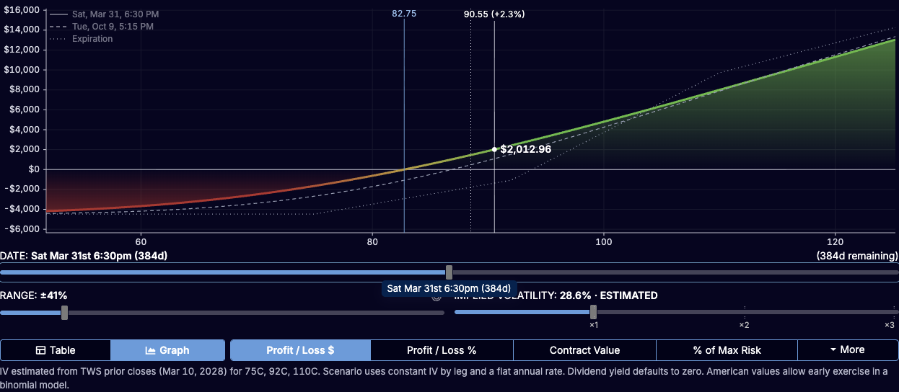

# TWS Options Lab

TWS Options Lab is a local options strategy builder for Interactive Brokers Trader Workstation. Use live or delayed broker quotes to plot a strategy, compare price and date scenarios, or review your own option executions. A Rust server connects to TWS over a local socket. A browser renders the charts and updates them automatically. Builder edits, simulated closes and spread groupings are local records. The application has no order-entry interface.



The graph above uses synthetic inputs from the browser verification suite.

## Quick start

1. Install a current stable Rust toolchain with Cargo and the native build tools for your operating system. The build compiles a bundled SQLite library. On macOS, the Xcode Command Line Tools supply the C compiler. [Install Rust](https://www.rust-lang.org/tools/install)
2. Sign in to TWS on the same computer. Under **Global Configuration → API → Settings**, enable **ActiveX and Socket Clients**, leave **Read-Only API** enabled and note the socket port. Standard TWS ports are **7497** for paper trading and **7496** for live trading. If TWS asks about a connection from this computer, check that it is the Options Lab instance you just started. [IBKR API setup](https://interactivebrokers.github.io/tws-api/initial_setup.html)
3. From the repository directory, start the server with the configured port. The first build downloads the dependencies in `Cargo.lock`.

   ```sh
   cargo run --locked -- --tws-port 7497
   ```

4. Open [Options Lab on this computer](http://127.0.0.1:18762/) in a current browser. Click the ticker, enter **SPX** or another optionable symbol, then choose the listing, trading class and expiration. In **Graph** view, quotes and curves update as data arrives.

On macOS, you can instead double-click **Start Options Lab.command**. The launcher builds the project and opens the local URL. From a POSIX terminal, pass options using a quoted script path.

```sh
"./Start Options Lab.command" --tws-port 7497 --port 18763
```

| Option | Purpose |
| --- | --- |
| `--tws-port PORT` | Connect to one configured TWS or IB Gateway port. With no override, the server tries 7497, then 7496. |
| `--port PORT` | HTTP port for the local browser. The default is 18762. |
| `--data-dir DIRECTORY` | Location of this instance’s SQLite library and broker history. The default is `.data/` in the project directory. |
| `--no-open` | Run the launcher without opening a browser. The plain Cargo command prints the URL. |

Keep the source checkout and its `web/` directory available at the path used to build the server. Stop the foreground process with Ctrl+C. If charts say **Waiting** or **Disconnected**, first check the TWS login, socket port and API authorization. A connected session can still lack a particular quote, news source or historical bar because of permissions or availability. [Data sources and coverage](DATA-SOURCES.md)

## Build and compare strategies

- **Instrument and chain.** Search by ticker or company name, use `SYMBOL#conId` for a specific broker contract, or browse a futures family such as `/ES`. A series identifies the underlying, trading class and expiration. The chain uses the strikes TWS qualifies for that series and subscribes to the visible window.
- **Positions.** Select a template or assemble individual legs. Click a strike to edit quantity and entry price. Drag a leg to a listed strike. Shift-drag the rail to move open strikes together, or a butterfly or condor wing to move the opposite wing. Each option uses its contract multiplier. The commission setting is in the listing currency per contract per side. The Positions panel can record a local partial or full closing fill or exclude a leg from a scenario.
- **Graph and table.** Drag **Date** between now and the first included option’s settlement. **Range** controls the price axis. The IV control scales the implied volatilities used for the scenario. Hover for the price and P&L on the selected curve. Choose currency P&L, percentage of entry, position value, percentage of bounded maximum loss, or a modeled Greek. The table arranges prices against dates. The scenario note identifies model assumptions and missing inputs.
- **Price models.** At settlement the payoff uses signed contract units and intrinsic value. Before settlement the builder uses broker model IV or a labeled estimate from compatible option and underlying prices. The estimate can use two-sided midpoints, timestamped trades or prior closes attributed to the same session. Known American-style contracts use a binomial approximation where early exercise matters. Futures-option pricing accounts for forward carry. Calendars model later expirations at the first settlement. Scenario P&L is a hypothetical value at the selected price and date.
- **Historical chart.** View observed session marks, available TWS bars or locally recorded saved-strategy marks. A single included option contract can also show one-minute candles. Historical prices, a local cost basis and a hypothetical scenario curve have distinct sources.
- **Optimize and Flow.** Optimize screens quoted verticals and bounded-loss templates by target price, date, risk, funding and pricing assumptions. Expiration bounds and modeled target P&L are separate measures. Individual leg quotes do not establish an executable package price. Flow displays subscribed updates, available historical prints, scanner results and entitled news or events.

## Saved trades and broker history

**Save trade** stores the builder’s entries and legs. Eligible live marks can be recorded while the server is running. Opening-leg edits create a separate scenario, while recorded closes can update the saved trade. **Previous** and **Current** compare saved and edited positions. Local JSON imports and exports carry strategy data. A copied strategy link encodes its legs and entries in the URL fragment and opens on another computer running Options Lab.

Open **Saved → Show → Expired or Closed** to inspect broker trades. The **Trades** view shows grouped positions, opening and closing dates, actual allocated commissions and realized option P&L when the required data is available. Expand a row to inspect the legs and execution IDs. IBKR’s reported FIFO result appears separately where supplied. The **Executions & lifecycle** view lists raw executions and broker-recorded expirations, assignments and exercises.

To group separately reported legs, choose **Group as spread**, select eligible trades or fills, and enter an optional name. **Preview spread** shows matched opening and closing quantities and the after-fee result. **Save spread** records the grouping for that broker account. Expand the saved grouping and choose **Ungroup spread** to restore its component trades. Partially selected lots retain their unselected quantities and fees.

## Import an Activity Flex statement

In IBKR Client Portal, create an Activity Flex Query in **XML** format. Include **Trades → Executions** with contract, underlying, date/time, side, quantity, trade price, multiplier, currency, IB Execution ID, commission and commission currency. For grouped histories, also include **Closed Lots**, brokerage and IB order IDs, order time, transaction ID, open/close indicator, opening date/time and realized P&L. Include **Transaction Type** and **Notes/Codes** to identify expirations, exercises and assignments. The parser supports date format `yyyyMMdd` and time format `HHmmss`. Record the timezone configured for the report. [Activity Flex queries](https://www.ibkrguides.com/complianceportal/complianceportal/activityflex.htm) · [Trades fields](https://www.ibkrguides.com/reportingreference/reportguide/tradesfq.htm)

In **Expired or Closed**, choose **Import Activity Flex XML**, select the files and set the statement timezone. The local Rust server validates and imports the XML. An optional Python CLI submits the same files to the running local server.

```sh
python3 scripts/import-ibkr-flex.py --timezone America/New_York "/path/to/activity.xml"
```

For broker-verified daily returns, supply final, unfiltered, single-day reports for the relevant prior and current regular sessions, plus each intervening civil date. Include all assets, executions, taxes, commissions, summary open positions, option exercises/assignments/expirations, corporate actions, transfers, trade transfers and transaction taxes. Preserve empty sections and generate each final report after the day ends. Select **Verify a trading day’s saved returns** during import to compare dated holdings and signed executions with venue cutoffs. Missing fields, conflicting activity, after-hours trades or ambiguous allocation can leave the result unavailable. The UI distinguishes verified broker amounts from saved-position scenarios. [Activity Flex sections](https://www.ibkrguides.com/reportingreference/reportguide/activity%20flex%20query%20reference.htm)

## Local data

The HTTP server binds to IPv4 loopback. SQLite files in the data directory can contain holdings, trades, execution IDs and account-scoped evidence. Browser storage can contain a strategy draft and chart settings. Keep that directory, Flex reports, exported libraries and personal strategy links private. For a file-level backup, stop the server and copy the entire data directory. Tests and development instances can use their own `--data-dir`.

## Verification

Run the following commands from the checkout. The calendar replay uses an isolated SQLite directory and a local TWS-protocol fixture. It exercises the native HTTP quote path without a brokerage login. The browser suite uses an isolated Chrome profile and fixture data.

```sh
cargo fmt --check
cargo check --locked
mkdir -p target/verification
python3 scripts/verify-quote-close-calendar.py target/verification/quote-calendar.json
node scripts/verify-options-history.mjs target/verification/options-history.json
```

Use Python 3 with `zoneinfo` for the replay and Node.js 22 or later with Chrome or Chromium for browser checks. Set `CHROME_BIN` to the browser executable if the default path is unavailable. Additional end-to-end scripts under `scripts/` cover Flex import, strategy valuation and manual spread grouping. Some use the Python and browser harnesses together.

The Linux CI workflow builds the locked Rust dependencies, checks formatting, runs the synthetic broker-ledger and scenario-date replays and uploads their evidence as the **options-lab-verification** artifact. [CI workflow](.github/workflows/verify.yml)

The separate `scripts/verify.mjs` suite queries a signed-in TWS session. Its market-dependent checks require permissions and current data for the requested instruments. Its JSON output can contain broker-supplied observations and should be kept local.

```sh
node scripts/verify.mjs target/verification/tws-live.json
```

The included fonts and independently distributed build dependencies have their own licenses. [Third-party notices](THIRD-PARTY-NOTICES.md)
