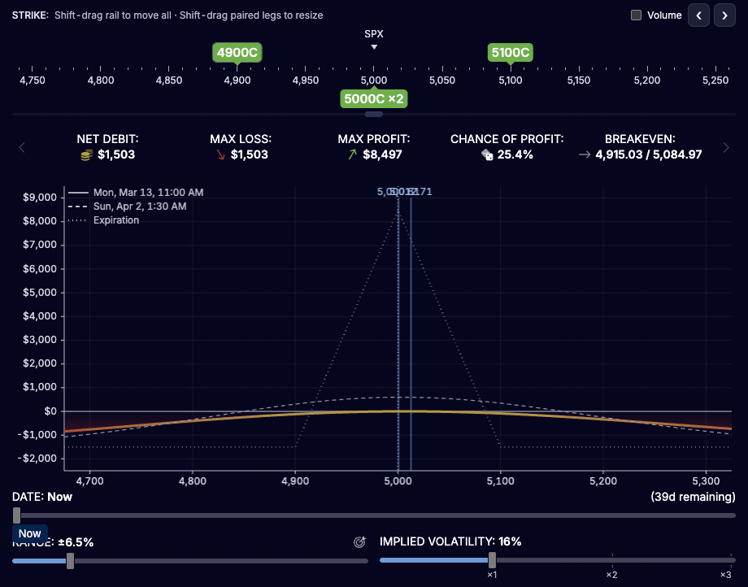
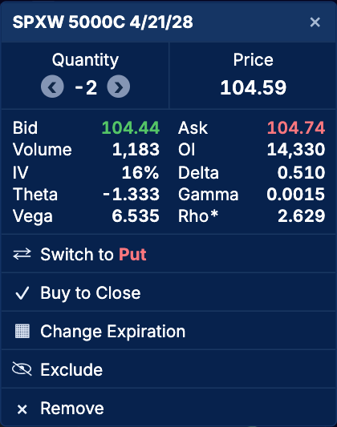
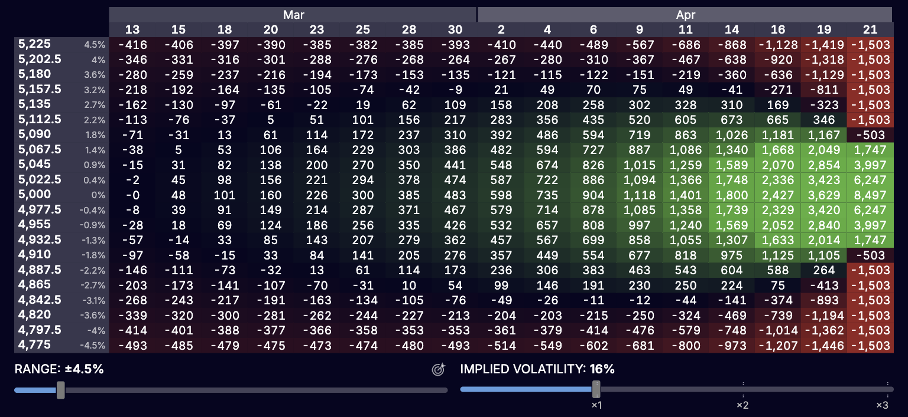
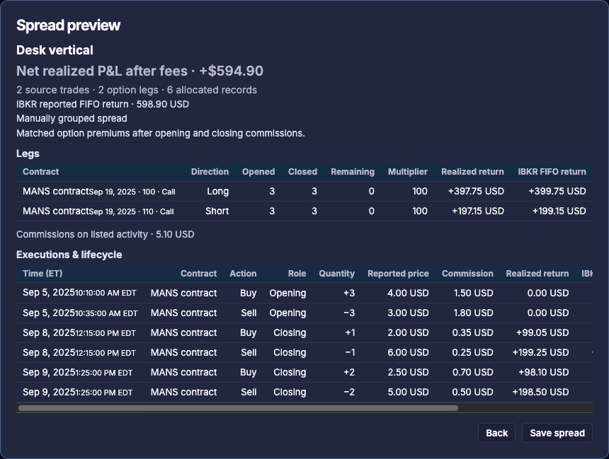

# 

Build an options spread with quotes from Interactive Brokers Trader Workstation, drag the date to see how its payoff changes, and review what your fills earned after commissions. A local Rust server connects to TWS and the chart refreshes automatically as quotes arrive. Your saved strategies and trade history stay on your computer.

[Quick start](#quick-start) · [Visual tour](#visual-tour) · [User guide](docs/guide.md) · [Market data coverage](DATA-SOURCES.md) · [MIT license](LICENSE)

## Quick start

1. Install **Git**, **Rust with Cargo**, and a C compiler. On macOS, the Xcode Command Line Tools supply the compiler. [Install Rust](https://www.rust-lang.org/tools/install)
2. Sign in to **TWS**. Under **Global Configuration → API → Settings**, enable **ActiveX and Socket Clients** and keep **Read-Only API** enabled. Note the socket port. Paper trading typically uses `7497` and live trading uses `7496`. [TWS API setup](https://interactivebrokers.github.io/tws-api/initial_setup.html)
3. Clone the repository and start the server. Substitute your configured port if it differs.

   ```sh
   git clone https://github.com/Acelogic/TWSOptionsLab.git
   cd TWSOptionsLab
   cargo run --locked -- --tws-port 7497
   ```

4. Open **[Options Lab](http://127.0.0.1:18762/)**, choose an optionable ticker and expiration, and select a strategy or add your own legs. On macOS, you can also launch the app by double-clicking **Start Options Lab.command**. [Startup options and troubleshooting](docs/guide.md#quick-start)

## Visual tour

The animation and screenshots show the running app with synthetic quotes and fills.

### Follow a spread from today to expiration

This SPX butterfly buys the 4,900 and 5,100 calls and sells two 5,000 calls. The solid curve shows modeled P&L on the selected date. The dotted line shows the payoff at expiration. Drag **Date** to watch the curves converge, or adjust **Range** and **Implied Volatility** to explore another scenario.



[View a still image of the full strategy builder](docs/payoff-graph.png)

<details>
<summary><strong>Inspect the 5,000 call</strong></summary>

Click a strike chip to see its quantity, entry price, bid, ask, and Greeks. **Buy to Close** records a local close for a short leg. **Exclude** lets you see how the other legs behave on their own.



</details>

### Compare prices and dates in one table

Switch to **Table** to read the same spread across underlying prices (rows) and dates (columns). Follow the **5,000** row to the final column to see the butterfly’s maximum expiration profit of **$8,497**. The wings settle at a **$1,503** loss.



### Trace a closed spread back to its fills

Under **Saved → Expired or Closed**, select related trades or fills and choose **Group as spread**. The preview keeps the legs together and shows how each execution contributes to the result. Here the legs earned **$600.00** before **$5.10** in commissions, leaving **$594.90**.



## Guides and verification

| What you want to do | Where to start |
| --- | --- |
| Choose a strategy, model Greeks, or screen spreads | [Build and compare strategies](docs/guide.md#build-and-compare-strategies) |
| Save trades, group older fills, or check daily returns | [Saved trades and broker history](docs/guide.md#saved-trades-and-broker-history) · [Activity Flex imports](docs/guide.md#import-an-activity-flex-statement) |
| Check which prices come from TWS and which values are modeled | [Market data sources](DATA-SOURCES.md) |
| Back up the local trade database | [Local data](docs/guide.md#local-data) |
| Reproduce the broker and browser checks | [Verification guide](docs/guide.md#verification) · [GitHub Actions runs](https://github.com/Acelogic/TWSOptionsLab/actions/workflows/verify.yml) |

## License

TWS Options Lab is available under the **MIT License**. The bundled Inter and Montserrat fonts use the SIL Open Font License. [MIT license text](LICENSE) · [Third-party notices](THIRD-PARTY-NOTICES.md)
